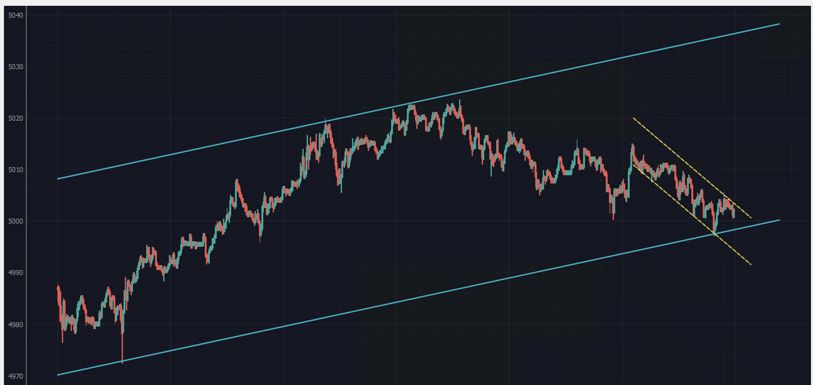
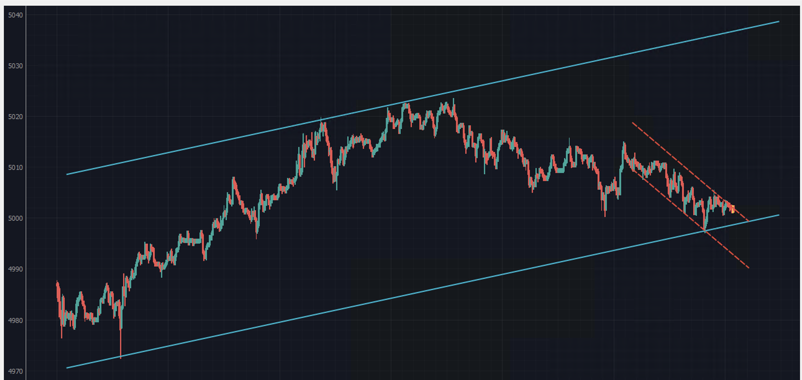
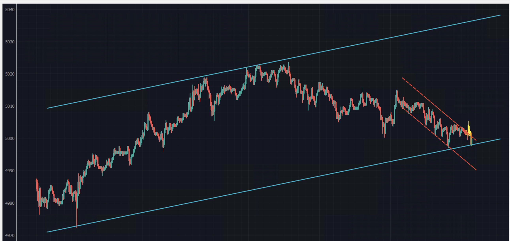
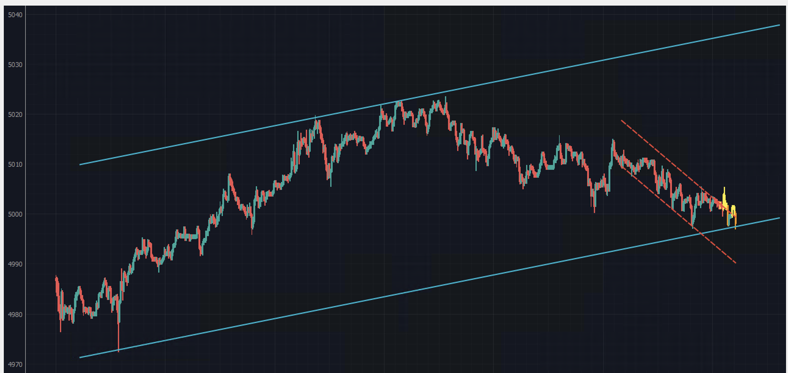
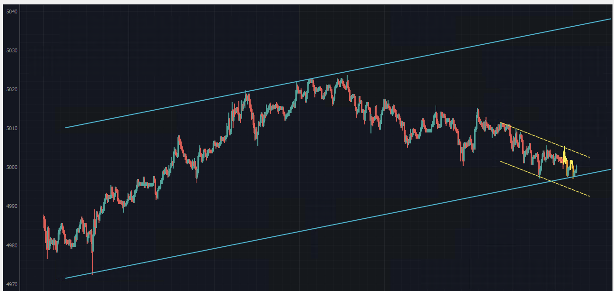
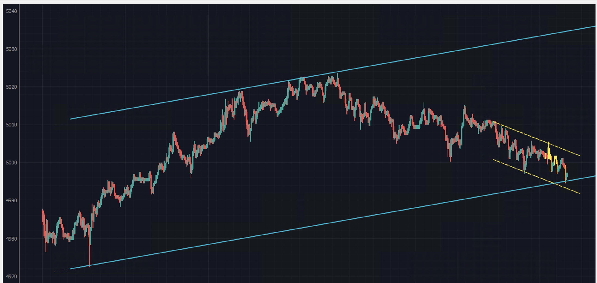
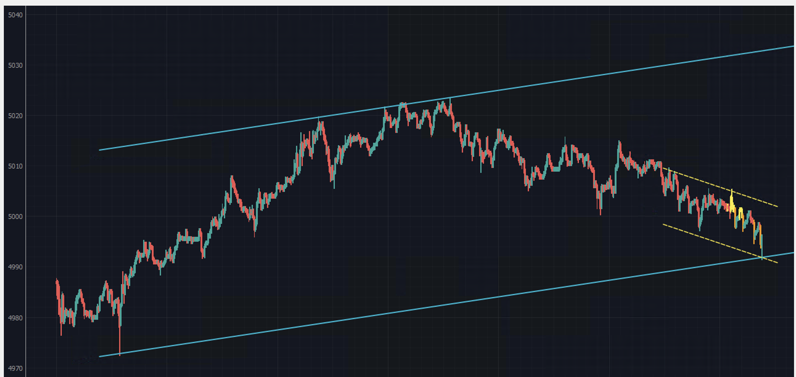
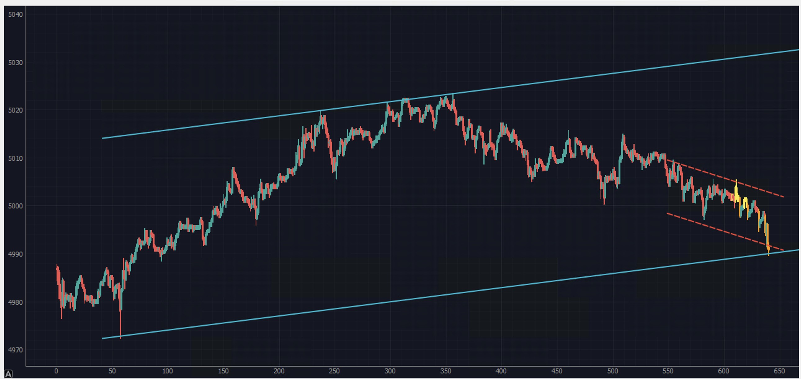
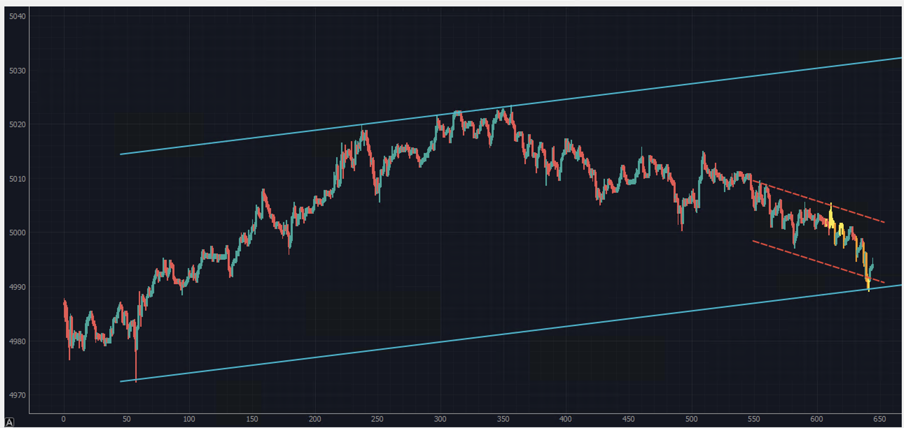
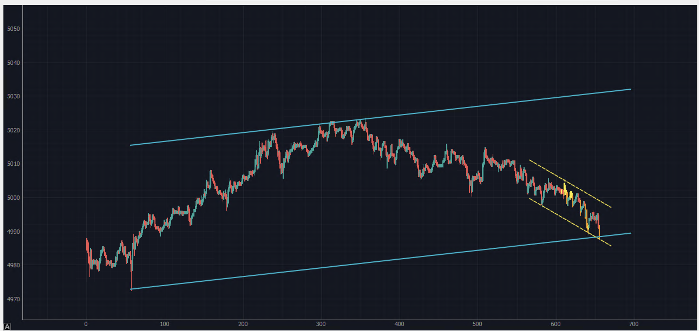

# Price Action Charts — Channel & Breakout Studies

Annotated **price action** studies: how price behaves inside a trend channel, where the counter‑channel forms, and what happens at the break.

This repo is a **visual study gallery**: 11 frames captured in one session (2026‑02‑16, 17:36 → 18:32). Same chart, 11 moments of annotation — read in order to see how the read develops.

---

## What the series shows

| Element | Meaning in the study |
| --- | --- |
| **Outer channel** (cyan) | The trend channel: upper and lower boundaries that contain the impulse and mark where the move is stretched. |
| **Inner counter‑channel** (red / yellow) | The retracement leg that forms after price tags the upper boundary — a smaller channel running against the main one. |
| **Yellow candles** | The active leg being tracked inside the counter‑channel: where momentum shifts or slows. |
| **Touch / break zones** | Where price meets a channel edge and either rejects or breaks out — the decision points. |

The 11 frames are **one chart at 11 moments of thinking**: channel drawn → counter‑channel identified → retracement tracked → break or rejection marked. They're not 11 separate setups, and they're annotated in hindsight.

---

## Gallery (chronological)

### 01 — 17:36:13

### 02 — 17:45:38

### 03 — 17:52:42

### 04 — 17:58:16

### 05 — 18:02:26

### 06 — 18:08:24

### 07 — 18:10:44

### 08 — 18:15:19

### 09 — 18:17:48

### 10 — 18:21:12

### 11 — 18:32:22

---

## Why this exists

Price action work lives in screenshots scattered across a desktop. Putting them in one ordered place keeps the reasoning attached to the chart: what was drawn, in what order, and what price actually did next.

---

## Disclaimer

These are **educational chart studies**, not financial advice and not signals. Annotations are manual and made in hindsight on TradingView; past structure does not predict future price. Nothing here is a recommendation to buy or sell any asset. Do your own research and manage your own risk.

---

*Charts: TradingView. Annotations: mine.*
